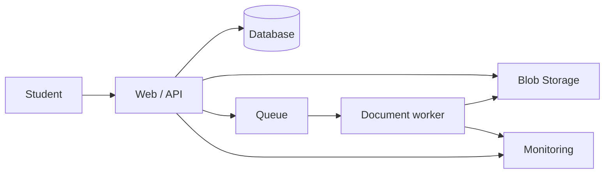

# Architecture and recovery

A sensible architecture starts with requirements: who uses the application, what data it handles, and how long it can be unavailable. Drawing more services does not answer those questions.

## Case study: notes application

- The database stores users, courses, and metadata.
- Blob Storage holds documents.
- A queue decouples slow tasks such as thumbnail generation.
- Monitoring exposes errors and timings.

This is a conceptual starting point. It does not include all the security, networking, or configuration needed for production.

## RTO and RPO

**RTO** is the target time for restoring service. **RPO** expresses the intended tolerance for recent data loss, measured in time.

If RPO is one hour, a daily backup alone does not meet that objective. If RTO is fifteen minutes, verify how long restoration actually takes.

An untested backup remains an assumption. Azure Backup protects supported workloads; Site Recovery focuses on replication and recovery of supported workloads. They are not equivalent.

## Designing for failure

- Retries with backoff and jitter for transient failures.
- Timeouts to avoid waiting indefinitely.
- Idempotent operations to tolerate repetition.
- Circuit breakers to avoid repeatedly calling a failing dependency.
- Explicit handling of partial failures.

## Balance

The Well-Architected Framework covers reliability, security, cost optimisation, operational excellence, and performance efficiency.

**My rule:** justify each component with a requirement. For a small assignment, multiple regions can add more complexity than value.

**Review:** replication does not remove the need to test restoration.

---

[Contents](README.md) · [Other language](../es/10-architecture.md) · [Previous](09-costs.md) · [Next](11-messaging.md)
