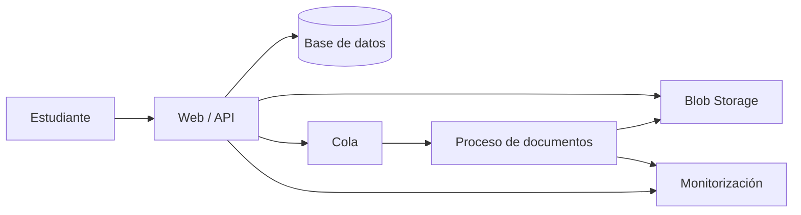

# Arquitectura y recuperación

Una arquitectura razonable empieza por requisitos: quién usa la aplicación, qué datos maneja y cuánto tiempo puede estar caída. Dibujar muchos servicios no responde a esas preguntas.

## Caso: aplicación de apuntes

- La base guarda usuarios, asignaturas y metadatos.
- Blob Storage guarda documentos.
- Una cola desacopla tareas lentas, como generar miniaturas.
- La monitorización permite ver errores y tiempos.

Es un punto de partida conceptual. No incorpora por sí solo toda la seguridad, red o configuración necesaria para producción.

## RTO y RPO

**RTO** es el tiempo objetivo para recuperar el servicio. **RPO** expresa cuánta pérdida de datos reciente se pretende tolerar, medida en tiempo.

Si el RPO es una hora, una copia diaria no basta por sí sola para ese objetivo. Si el RTO es quince minutos, hay que comprobar cuánto tarda realmente una restauración.

Un backup no probado sigue siendo una suposición. Azure Backup protege cargas compatibles; Site Recovery se centra en replicación y recuperación de cargas admitidas. No son equivalentes.

## Diseñar para fallos

- Reintentos con espera progresiva y variación aleatoria para fallos transitorios.
- Límites de tiempo para no esperar indefinidamente.
- Operaciones idempotentes para tolerar repeticiones.
- Circuit breaker para evitar insistir en una dependencia que falla.
- Gestión explícita de fallos parciales.

## Equilibrio

El Well-Architected Framework trata fiabilidad, seguridad, optimización de costes, excelencia operativa y eficiencia del rendimiento.

**Mi criterio:** justificar cada componente con un requisito. Para una práctica pequeña, varias regiones pueden aportar más complejidad que valor.

**Repaso:** replicar no elimina la necesidad de probar la restauración.

## Ejemplo resuelto: restaurar es más que copiar

La base se restaura, pero la API sigue apuntando al servidor antiguo y el proceso de documentos no tiene permisos en el nuevo almacenamiento. Los datos existen, pero el servicio continúa caído.

El runbook debe incluir configuración, identidades, DNS, red, dependencias y comprobaciones. También quién decide el cambio y cómo se comunica.

## ADR mínimo

Una decisión puede documentarse en una página:

1. Contexto y requisito medible.
2. Opciones consideradas.
3. Elección y razón.
4. Consecuencias y limitaciones.
5. Evidencia de validación.
6. Condición para revisar la decisión.

No hace falta convertirlo en burocracia: ayuda a recordar por qué se eligió algo cuando cambian los requisitos.

**Ejercicio:** el presupuesto se reduce a la mitad, pero RPO y RTO siguen iguales. Explica qué alternativas investigarías y qué requisito no puedes dar por satisfecho sin volver a medir.

---

[Índice](README.md) · [Otro idioma](../en/10-architecture.md) · [Anterior](09-costs.md) · [Siguiente](11-messaging.md)
